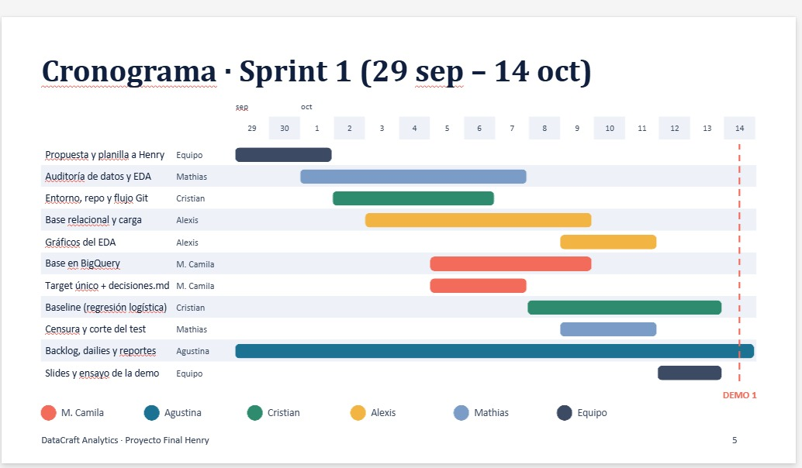
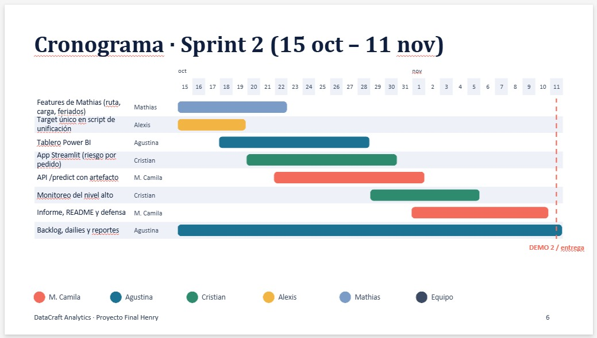
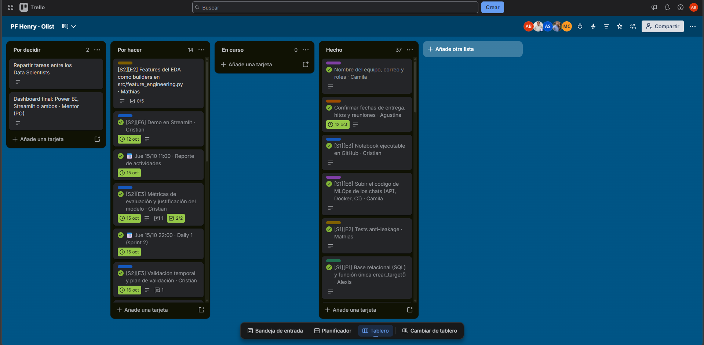
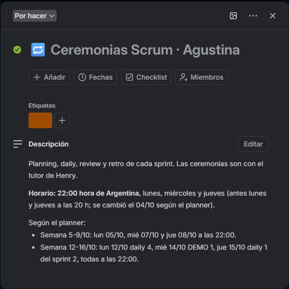

# Retrospectiva de los sprints

**Proyecto:** DataCraft Analytics — Olist  
**Scrum Master:** Agustina  
**Sprint 1:** del 29/09 al 14/10  
**Sprint 2:** del 15/10 al 28/10  

## 1. Objetivo

Revisar la forma de trabajo del equipo durante los dos sprints, identificar las prácticas que facilitaron el avance del proyecto y establecer oportunidades de mejora para futuras experiencias.

Este balance recoge la información aportada por la Scrum Master sobre la organización y la colaboración del equipo.

## 2. Organización y seguimiento

El equipo utilizó Trello y un planner como herramientas de planificación y seguimiento. Estas permitieron distribuir responsabilidades, organizar las actividades y registrar los horarios de las reuniones.

Agustina desempeñó el rol de Scrum Master, con responsabilidades de organización del backlog, seguimiento de tareas, coordinación de reuniones y elaboración de reportes.

En Trello, las tareas finalizadas se identificaron mediante una marca verde. Sin embargo, algunas tarjetas permanecieron en la columna “Por hacer” después de completarse. Por este motivo, la ubicación de las tarjetas no siempre reflejó el estado real del trabajo.

## 3. Retrospectiva del sprint 1

### Qué funcionó bien

- **Distribución de responsabilidades:** el reparto de tareas redujo la carga individual y permitió avanzar con rapidez.
- **Comunicación entre integrantes:** el intercambio frecuente facilitó la resolución de dudas y conflictos relacionados con el trabajo.
- **Colaboración:** el trabajo conjunto permitió coordinar los aportes individuales y avanzar hacia los objetivos del sprint.
- **Cumplimiento de las tareas:** se completaron las actividades previstas, sin trasladar tareas pendientes al segundo sprint.

### Oportunidades de mejora

- Mantener actualizadas las columnas de Trello para facilitar la lectura del avance.
- Definir fechas y horarios de finalización para las tareas que requieran coordinación entre integrantes.
- Reservar tiempo para revisar e integrar los entregables antes de cada presentación.

### Aprendizajes

La distribución de tareas y la buena comunicación fueron prácticas útiles para el equipo. Se identificó la conveniencia de mantenerlas durante el segundo sprint y complementar el seguimiento con una actualización más consistente del tablero.

## 4. Retrospectiva del sprint 2

### Qué funcionó bien

- **Continuidad en la colaboración:** el equipo mantuvo la distribución de responsabilidades y el apoyo entre integrantes.
- **Resolución de dudas y conflictos:** la buena comunicación facilitó la coordinación y la búsqueda de soluciones.
- **Avance de las actividades:** la organización del trabajo permitió completar las tareas técnicas previstas para el sprint.

Al momento de elaborar este documento, las tareas técnicas del segundo sprint se encuentran finalizadas. Las actividades restantes corresponden a la retrospectiva y a la documentación de cierre del proyecto.

### Oportunidades de mejora

- **Consistencia del tablero:** mover las tarjetas completadas a “Hecho”, además de marcarlas como finalizadas.
- **Plazos de entrega:** establecer fechas y horarios límite para determinadas tareas, especialmente cuando su resultado sea necesario para el trabajo de otro integrante.
- **Cierre documental:** incorporar la documentación al seguimiento de tareas y reservar tiempo para completarla junto con los entregables técnicos.

### Aprendizajes

El trabajo en equipo permitió reducir la carga individual y avanzar con rapidez. Para mejorar la visibilidad del progreso, es necesario que las herramientas de seguimiento reflejen de manera consistente el estado de las actividades.

También resulta conveniente contemplar la revisión, la integración y la documentación dentro de la planificación de cada entrega.

## 5. Plan de mejora para futuros proyectos

| Acción | Responsable propuesto | Momento de aplicación |
| --- | --- | --- |
| Mantener el reparto de responsabilidades y los espacios de comunicación. | Todo el equipo. | Durante cada sprint. |
| Revisar el tablero y mover las tareas completadas a “Hecho”. | Cada responsable de tarea, con seguimiento de la Scrum Master. | Al completar una tarea y al finalizar las reuniones de seguimiento. |
| Registrar fechas y horarios de entrega para las tareas que requieran coordinación. | Responsable de cada tarea, junto con el equipo. | Durante la planificación y ante cambios de alcance. |
| Reservar tiempo para revisar e integrar los entregables. | Todo el equipo. | Antes de cada demo o entrega. |
| Incluir la documentación como parte de las tareas planificadas. | Responsable de cada entregable, con seguimiento de la Scrum Master. | Desde la planificación hasta el cierre del sprint. |

Estas acciones se proponen a partir del balance realizado, para mantener las prácticas que funcionaron y mejorar la organización en futuros proyectos.

## 6. Evidencias de organización

### Cronograma del sprint 1

### Cronograma del sprint 2

**Aclaración:** el cronograma original muestra un cierre el 11/11.
El período correcto, confirmado por la Scrum Master, es del 15/10 al 28/10.

### Tablero de Trello

Las marcas verdes identifican tareas completadas, aunque algunas
tarjetas permanecen en la columna “Por hacer”.

### Registro de ceremonias Scrum

La tarjeta registra la organización y los horarios previstos
para las ceremonias del equipo.
